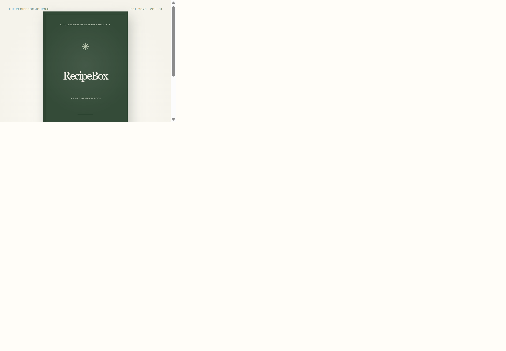
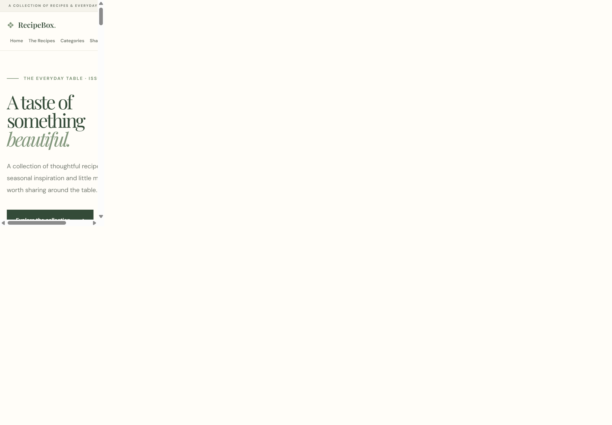
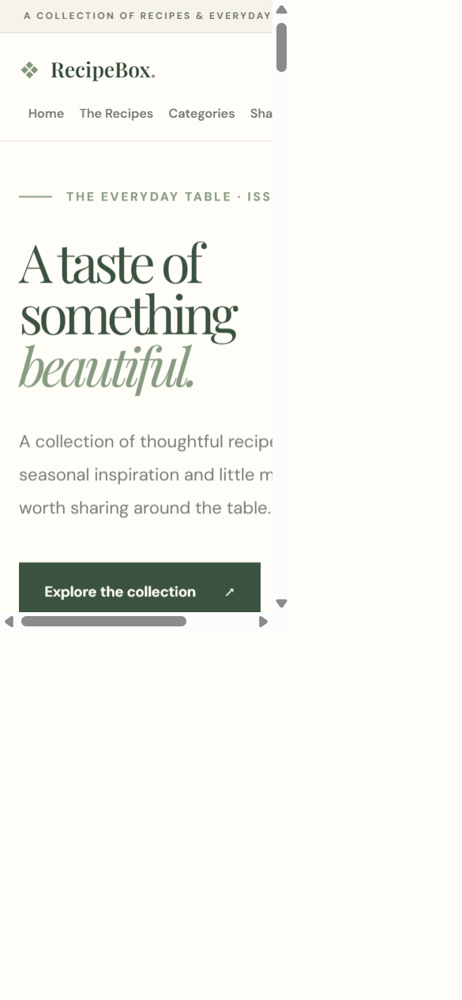
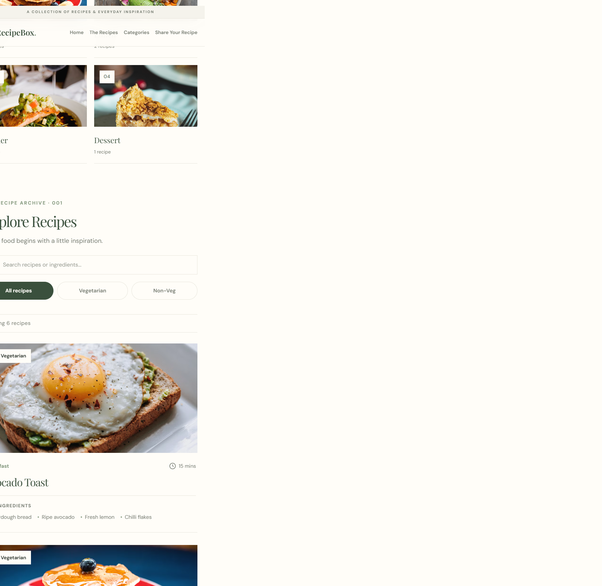
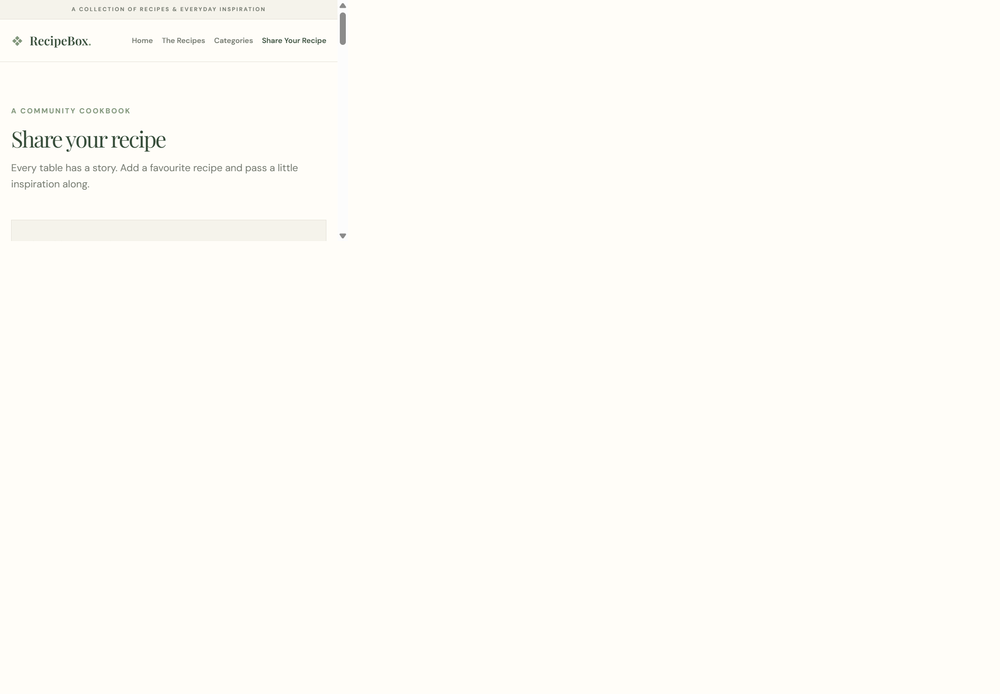
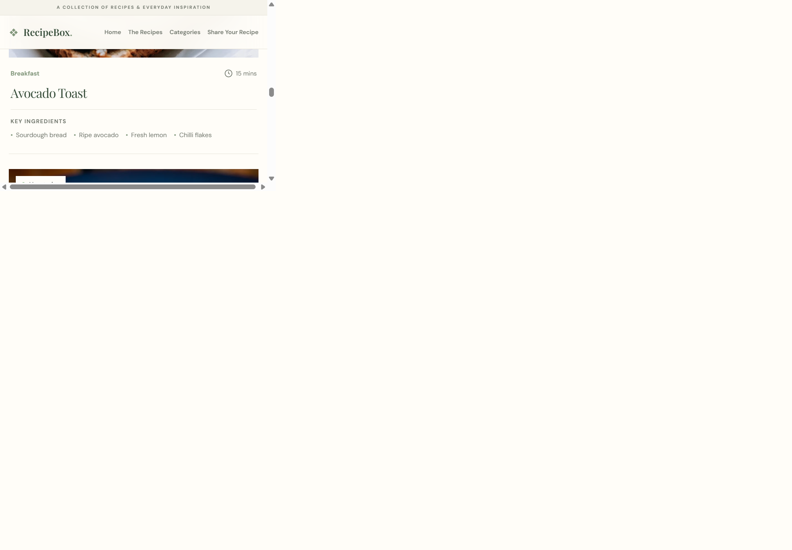

# 🌿 RecipeBox | A Digital Cookbook

A beautifully designed, interactive digital cookbook built with React.js and Vite. Explore recipes, discover ingredients, and share your own culinary creations through a modern cookbook-inspired experience.

## ✨ Features

### 📖 Interactive Cookbook
- Book-inspired opening animation.
- Premium botanical design.
- Responsive layout.

### 🍲 Recipe Collection
- Browse a collection of recipes.
- View recipe details and ingredients.
- Veg and Non-Veg identification.
- Explore different recipe categories.

### 🔍 Search & Filters
- Search recipes.
- Search by recipe ingredients.
- Filter by category.
- Filter Veg and Non-Veg recipes.

### 📝 Share Your Recipe
- Submit your own recipes.
- Add recipe name, category and cooking time.
- Include ingredients and cooking instructions.
- Upload a food photograph or publish without one.
- Preview uploaded photographs.
- Display a default image when no photograph is provided.
- See newly submitted recipes in the collection.
- Delete locally submitted recipes with confirmation.

### 💾 Browser Storage
- Save community recipes locally.
- Retain saved recipes after refreshing the browser.
- No backend or database required.

**Note:** Community recipes are stored locally in the visitor's browser and are not automatically shared across devices or with other visitors.

## 🎨 Design Palette

| Colour | Hex Code |
|---|---|
| Sage Green | `#82977C` |
| Deep Forest | `#344B38` |
| Warm Cream | `#F5F3EB` |
| Soft White | `#FFFDF8` |
| Muted Beige | `#E8E4D8` |

## 🛠️ Technologies

- React.js
- Vite
- JavaScript
- HTML5
- CSS3
- React Hooks
- Browser Storage

## 📂 Project Structure

```text
recipebox/
├── public/
│   ├── favicon.svg
│   └── icons.svg
├── src/
│   ├── assets/
│   ├── components/
│   │   ├── BookIntro.css
│   │   ├── BookIntro.jsx
│   │   ├── header.jsx
│   │   ├── IngredientList.jsx
│   │   ├── recipecard.jsx
│   │   ├── RecipeDetails.css
│   │   ├── RecipeDetails.jsx
│   │   ├── ShareRecipe.css
│   │   └── ShareRecipe.jsx
│   ├── data/
│   │   ├── communityRecipes.js
│   │   └── recipe.js
│   ├── app.css
│   ├── app.jsx
│   ├── index.css
│   └── main.jsx
├── .gitignore
├── eslint.config.js
├── index.html
├── package-lock.json
├── package.json
├── README.md
└── vite.config.js
```

## 🚀 Getting Started

### Prerequisites
- Node.js
- npm

### Installation

**1. Clone the repository**

```bash
git clone YOUR_GITHUB_REPOSITORY_URL
```

**2. Navigate to the project folder**

```bash
cd recipebox
```

**3. Install dependencies**

```bash
npm install
```

**4. Start the development server**

```bash
npm run dev
```

Open the local URL displayed in your terminal.

## 📸 Screenshots

These screenshots are saved in the [`screenshots/`](screenshots/) folder and
embedded below so they display in the repository README.

### Cookbook opening


### Homepage




### Recipe collection


### Recipe details


### Share a recipe


### Community recipe


## 🎯 Project Objective

RecipeBox was created to explore React.js development through an interactive digital cookbook.

The project demonstrates component-based architecture, reusable components, props, state management, dynamic rendering, search and filtering, form handling and browser-based data persistence.

## 🌱 Future Improvements

- Recipe ratings and reviews.
- Favourite recipes.
- Advanced recipe discovery.
- Shared community recipe collections.

## 👩‍💻 Author

**Ankita**

Frontend Development Project

---

*Made with 🌿 and a love for good food.*